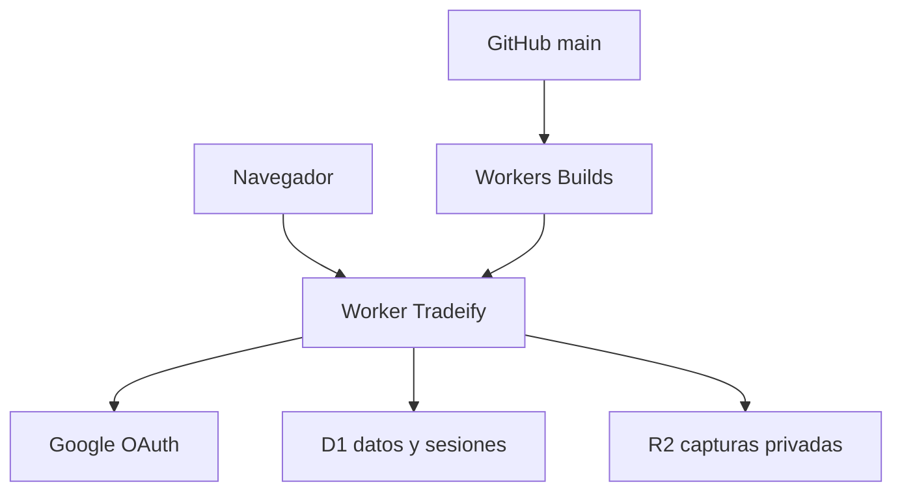

# Arquitectura y estructura

GitHub conserva el código. Cloudflare Workers Builds publica los cambios de `main` en el Worker `tradeify`. Google identifica a cada usuario y D1 conserva registros y sesiones revocables. R2 conserva las imágenes heredadas cuando está configurado; las nuevas capturas son enlaces de texto en D1. El navegador consulta las vistas previas externas directamente, nunca el servidor. El perfil alternativo de Sites usa la puerta de acceso de ChatGPT y su propio flujo de publicación.

La página de servidor obtiene la identidad. La interfaz consulta el diario y envía mutaciones validadas por Zod al repositorio Drizzle. Las imágenes usan otra API con control de propiedad/revisión. Las estadísticas se calculan mediante funciones puras sobre registros cargados.

| Ruta | Responsabilidad |
| --- | --- |
| `app/page.tsx` | Acceso e identidad |
| `app/layout.tsx`, `app/globals.css` | Documento, metadatos, diseño, temas e impresión |
| `app/chatgpt-auth.ts` | Lectura de identidad establecida por el Worker o Sites |
| `app/api/bitacora/route.ts` | Lectura y mutaciones |
| `app/api/capturas/route.ts` | Lectura/borrado de imágenes heredadas; sin PUT |
| `app/api/frase-diaria/route.ts` | Entrega diaria, por usuario y día hábil de Ecuador |
| `components/journal/app.tsx` | Estado, navegación, filtros y API |
| `components/journal/dashboard.tsx` | Resumen y calendario |
| `components/journal/trade-list.tsx` | Listado y CSV |
| `components/journal/trade-editor.tsx` | Formulario |
| `components/journal/trade-detail.tsx` | Detalle y capturas |
| `components/journal/analytics.tsx` | Estadísticas, psicología y revisión |
| `components/journal/settings.tsx`, `ui.tsx` | Configuración y elementos compartidos |
| `components/ui/`, `hooks/` | Biblioteca de plantilla; no todos sus componentes se usan |
| `db/schema.ts`, `index.ts`, `repository.ts` | Tablas, conexión DB y persistencia |
| `lib/journal.ts` | Tipos, validaciones, fechas, dinero y R |
| `lib/stats.ts`, `csv.ts`, `demo.ts` | Métricas, intercambio y ejemplo ficticio |
| `lib/server-http.ts` | Identidad, límites y respuestas |
| `lib/connector*`, `components/connector-error.tsx` | Infraestructura de conectores heredada de Sites |
| `drizzle/` | Migraciones de bitácora, progreso de frases, sesiones y metadatos |
| `worker/index.ts` | Entrada Worker y envoltura de conectores |
| `worker/cloudflare.ts`, `worker/google-auth.ts` | Entrada Cloudflare, OAuth, sesiones, límites y eventos |
| `worker/security-headers.ts` | Privacidad de respuestas y cabeceras de protección |
| `wrangler.cloudflare.jsonc`, `scripts/cloudflare.mjs` | Configuración independiente y flujo build/migración/deploy |
| `.openai/hosting.json` | Proyecto y bindings DB/BUCKET |
| `vite.config.ts`, `next.config.ts` | Compilación/adaptación del framework |
| `cloudflare-env.d.ts`, `tsconfig.json` | Tipos de entorno y TypeScript |
| `scripts/` | Instalación, entorno, ejecución y plugins Sites |
| `public/`, `vendor/` | Icono, fuente local, CSS y licencias |
| `examples/` | Ejemplo D1 de plantilla fuera del App Router principal |
| `tests/check-api.mjs`, `check-cloudflare.mjs` | Integración D1/R2, permisos y acceso Google simulado |
| `tests/check-export.mjs`, `check-capture-failures.mjs` | Exportaciones y fallos de confirmación de capturas |
| `package.json`, `package-lock.json` | Comandos y dependencias reproducibles |
| `documentacion/` | Manual funcional y técnico |
| `SEGURIDAD_INFORME.md` | Auditoría, correcciones, evidencia y pendientes |

Navegación hash: resumen, bitacora, estadisticas, psicologia, revision y configuracion. No son servidores independientes. Al recuperar visibilidad se refrescan datos. `dist`, `node_modules`, estado `.wrangler`, archivos de entorno y temporales se regeneran y no se versionan. Se preservan nombres de plantilla en infraestructura para no romper su funcionamiento.

Google y el acceso por correo comparten worker/session.ts. worker/email-login.ts gestiona los códigos. worker/resend.ts es el adaptador de entrega y puede sustituirse sin cambiar las sesiones.

Mercados monta el gráfico avanzado y el calendario solo al visitar esa sección. El cargador conserva una promesa por módulo durante la navegación. Solo se envía el símbolo público, sin operaciones ni indicadores privados. El widget externo mantiene su atribución, la zona horaria del gráfico es America/Guayaquil y el tema sigue la interfaz.

## Administración y autorización
El perfil Cloudflare autoriza en worker/access.ts después de verificar Google y cada sesión en D1. /administracion y /api/admin requieren el correo verificado TRADEIFY_OWNER_EMAIL. Las páginas comprueban además la cabecera interna que el Worker reconstruye. El rol nunca se acepta del navegador. Los POST administrativos exigen mismo origen y X-Bitacora-Request. La API no devuelve operaciones de otros usuarios.

worker/status-page.ts presenta los rechazos de acceso y errores de páginas mediante HTML autocontenido, antes de la aplicación privada. Las API conservan sus códigos HTTP y reciben JSON con error. La página nunca concede una sesión ni cambia permisos. Las políticas públicas permanecen accesibles para una identidad denegada. Las cabeceras auxiliares con identidad verificada se eliminan de la respuesta final.

Modal comparte historial, foco y confirmación de descarte. presentation adapta las tareas largas a pantallas móviles completas. lib/editor-draft.ts valida el contrato local de los borradores. La versión actual del trade debe coincidir antes de recuperar un borrador.
