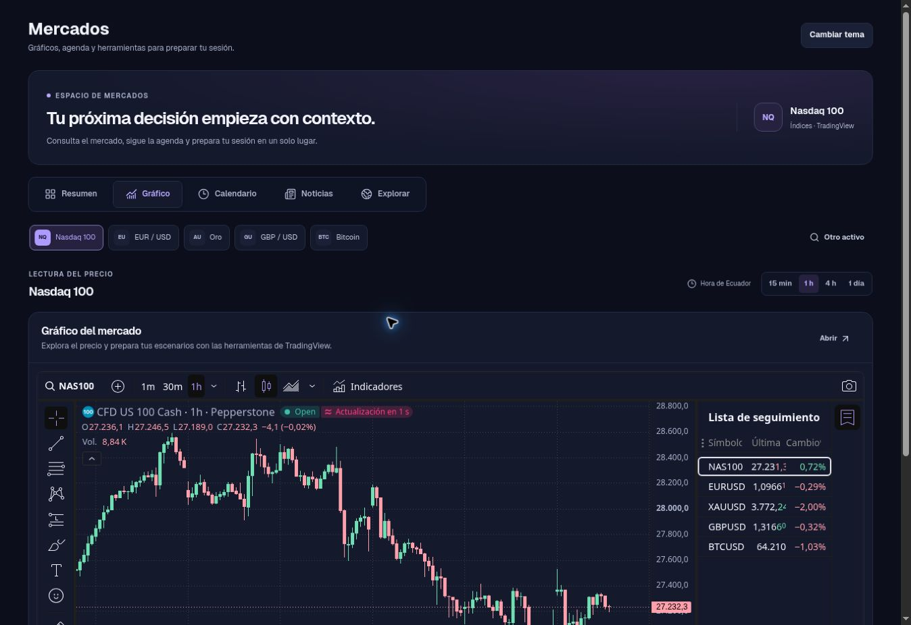

# Mercados · TradingView

Esta actualización afecta únicamente a Mercados, sus estilos, cargador y pruebas. No cambia la autenticación, los permisos, las operaciones guardadas ni la base de datos. No necesita migraciones o variables nuevas.

## Organización

| Vista | Herramientas |
|---|---|
| Gráfico (inicial) | Gráfico avanzado, selección de activo y temporalidad |
| Resumen | Resumen de mercado y panorama de índices, Forex y cripto |
| Calendario | Calendario económico |
| Noticias | Noticias financieras |
| Explorar | Mapa de calor, tabla Forex, análisis técnico, datos de mercado, panorama mundial, mapa económico y fundamentales |

Se integran los once Web Components enviados y el widget de fundamentales basado en iframe. Los fundamentales usan una empresa elegida por separado: un CFD del Nasdaq o una divisa no equivale a una empresa con cuentas financieras.

## Diseño y carga

Los colores, tipografía y componentes de Tradeify se conservan. Los tokens CSS oficiales de TradingView se aplican solo dentro de .markets. Las vistas secundarias se montan al abrirlas; Explorar mantiene únicamente su herramienta seleccionada. El gráfico se conserva al cambiar de pestaña durante la visita a Mercados. Al salir de Mercados se desmontan los widgets. No se guardan dibujos de TradingView en D1.

Los módulos se descargan una vez por tipo y documento. Los fallos eliminan la promesa rechazada y el script fallido; Reintentar permite un nuevo intento. Existe un plazo de carga de 15 segundos, incluyendo el registro del elemento personalizado. Un componente registrado no acredita que todos los datos externos estén disponibles: la interfaz conserva acceso a la fuente original. El tema, símbolo y temporalidad de Web Components se actualizan mediante atributos, sin reemplazar su elemento. El iframe de fundamentales se reinicia al cambiar su empresa o tema, como requiere ese formato.

Las pestañas permiten flechas, Inicio y Fin, con relaciones ARIA y foco visible. En móvil las pestañas y favoritos se desplazan dentro de su fila y los contenedores usan columnas con mínimo cero para evitar desbordamientos.

## Activos, idioma y hora

Se reconocen nombres habituales como US100/Nasdaq, EURUSD, GBPUSD y Oro/XAUUSD. Se conservan los símbolos explícitos EXCHANGE:NAME. La asociación de US100 a PEPPERSTONE:NAS100 muestra un instrumento público de referencia; sus precios pueden diferir del bróker de la cuenta. Si el último activo no se reconoce, se utiliza TRADEIFY_MARKET_SYMBOL o EUR/USD como antes. La selección manual se conserva durante la visita. El selector de Tradeify controla sus herramientas; los cambios internos del buscador de TradingView no se sincronizan mediante eventos no documentados.

Se comprobó respuesta HTTP 200 y contenido JavaScript de las once rutas /w/es/ utilizadas. El gráfico usa America/Guayaquil. El calendario no anuncia un atributo de zona horaria en el módulo inspeccionado: la interfaz pide revisar su zona y filtros, sin prometer una configuración no soportada. Los títulos originales de noticias o eventos pueden venir en otros idiomas.

## Privacidad y verificación

Los widgets se cargan directamente en el navegador desde dominios oficiales. No se descargan precios, noticias o imágenes desde el Worker ni se guardan esos contenidos en D1. Las configuraciones solo contienen símbolos y ajustes públicos; no incluyen balances, notas, IDs de cuenta o el historial. Se mantienen las atribuciones y los enlaces externos usan noopener noreferrer.

Pruebas automatizadas: símbolos y entradas hostiles, selección del último activo, catálogo permitido, idioma de las URLs, descarga única, reintento tras error, timeout durante registro, actualización de atributos sin reemplazar el elemento, watchlist sin duplicados y ausencia de una zona horaria inventada para el calendario. Se ejecutan además lint, TypeScript, compilación y las suites existentes de regresión.

La revisión de navegador utiliza el componente real con símbolos públicos en una vista local de prueba; no requiere credenciales de producción. Se comprueban navegación, temas, carga de widgets y ancho de 370 px. La disponibilidad de todos los instrumentos, las demoras de cada mercado y la correspondencia con cotizaciones de un bróker siguen dependiendo de TradingView, sin garantía de actualización instantánea.

Fuentes oficiales: https://www.tradingview.com/widget-docs/widget-formats/ , https://www.tradingview.com/widget-docs/tutorials/web-components/styling-and-themes/ y https://www.tradingview.com/widget-docs/tutorials/web-components/layout-and-sizing/ .

## Resultado de validación · 18 de noviembre de 2026

Aprobados: lint (cero errores; aviso previo de img en trade-detail.tsx), TypeScript, build:cloudflare con bindings ficticios locales, build, check-markets, check-export, check-capture-links, check-status-pages, check-cloudflare, check-api y check-capture-failures. No se aplicaron migraciones remotas ni se alteraron secretos.

Revisión visual local: gráfico, calendario, resumen y fundamentales con datos reales; navegación por los cinco apartados y las siete herramientas de Explorar; temas claro y oscuro; navegación de teclado y rechazo de símbolos inválidos. A 370 px se corrigió y verificó el desbordamiento horizontal. No se ha verificado el despliegue de Cloudflare ni la disponibilidad individual de todos los mercados en producción.

